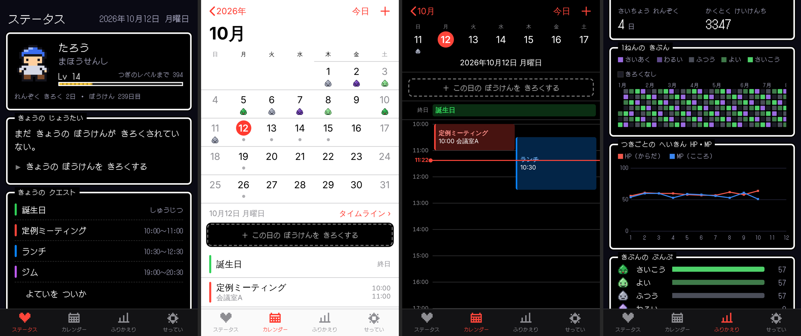

# ドット絵クエスト日記

その日の気分や体調を **HP・MP** などの RPG 風ステータスで記録し、
冒険（日常）をカレンダーやグラフでふりかえる iPhone 向け日記アプリです。



- **ステータス**：ドット絵の勇者・レベル・経験値。今日の HP / MP / きぶん / じょうたい、今日の予定（クエスト）、最近7日のきぶん
- **日記**：きぶん（5段階のスライム）、HP（からだ）、MP（こころ）、じょうたい、こうどう（なにをしたか・自由に追加可）、ひとこと、本文。書くたびに経験値が入り、レベルと称号が上がります
- **カレンダー**：iPhone 純正カレンダー風の **年 → 月 → 日** 表示
  - 月表示：今日は赤丸、選択日は白丸、予定はドット、日記を書いた日はスライムのアイコン。上下・左右スワイプで月移動
  - 選択日の下に、その日の日記（ステータス）と予定の一覧
  - 日表示：週のストリップ、終日予定、時間軸タイムライン（現在時刻の赤線、重なる予定は横並び）。空き時間をタップでその時刻に予定追加
  - 予定：終日 / 開始・終了 / 繰り返し（毎日・毎週・毎月・毎年＋終了日）/ カレンダー（色分け）/ 場所 / メモ
- **ふりかえり**：週・月・年ごとに
  - RPG 風のまとめ文（「〇〇は この しゅう しごとを 5かい した！」）
  - 記録日数・予定数・平均 HP/MP・最長連続記録・獲得経験値
  - HP/MP の推移グラフ、気分カレンダー、1年の気分ヒートマップ、気分の分布
  - よくしたこと ランキング、予定のカレンダー別件数、日記一覧
- **連携**
  - 日記とカレンダーは同じ日付でつながっていて、どの画面からもその日の日記と予定を行き来できます
  - `.ics` の読み込み（iPhone 純正 / Google カレンダーから書き出したもの）と書き出し
  - 予定ごとに「iPhoneのカレンダーにも追加（.ics）」ボタン
- **バックアップ**：すべてのデータを JSON で書き出し・読み込み

## iPhone で使う

ビルド不要の PWA（ホーム画面に追加できる Web アプリ）です。データは iPhone の中（ブラウザのストレージ）だけに保存されます。

1. このリポジトリを GitHub Pages で公開する
   （GitHub の **Settings → Pages → Build and deployment** で
   Source を「Deploy from a branch」、Branch を公開したいブランチの `/ (root)` にして保存）
2. iPhone の Safari で公開された URL を開く
3. 共有ボタン（□↑）→「ホーム画面に追加」

ホーム画面から開くと全画面のアプリとして動き、一度開けばオフラインでも使えます。

> ⚠️ Safari の「履歴とWebサイトデータを消去」をするとデータも消えます。
> ときどき「せってい → ぼうけんのしょを かきだす」でバックアップしてください。

## 手元で動かす

```sh
npx http-server -p 8080 .   # または python3 -m http.server 8080
```

ブラウザで http://localhost:8080 を開きます（ES Modules を使っているので `file://` 直開きでは動きません）。

テスト（予定の繰り返し展開・.ics 入出力・レベル計算）:

```sh
node --test tests/*.test.mjs
```

## 構成

```
index.html              エントリポイント
manifest.webmanifest    PWA マニフェスト
sw.js                   オフライン用 Service Worker
css/style.css           RPG 風 UI と iOS 風カレンダーのスタイル
js/app.js               タブ切り替え
js/store.js             データ保存（localStorage）・経験値/レベル
js/events.js            予定の繰り返し展開・.ics 入出力
js/sprites.js           ドット絵（文字マップ → SVG）
js/diaryEditor.js       日記を書くシート
js/eventEditor.js       予定の追加・編集シート
js/views/               ステータス / カレンダー / ふりかえり / せってい 画面
tests/                  node:test のテスト
```

ファイルを更新したら `sw.js` の `VERSION` を上げると、インストール済みの端末でも新しい版に切り替わります。
